# Звіт з лабораторної роботи №3. Модифікація даних та транзакції

**Виконав:** Мартинюк Максим Віталійович  
**Група:** ІПЗ-31  
**Варіант:** Система управління бібліотекою  
**Обраний рівень складності:** Рівень 3 (Високий рівень — оцінка «відмінно»)

---

## 🎯 Мета роботи

Здобути практичні навички безпечної модифікації даних у реляційних базах даних, опанувати механізми транзакцій для забезпечення цілісності даних (ACID), навчитися працювати з обмеженнями цілісності, каскадними операціями, тригерами аудиту, блокуваннями при паралельному доступі та збереженими процедурами в СКБД PostgreSQL.

---

## 🖥️ Підготовка середовища

Робота виконувалась в операційній системі **Ubuntu Linux** із використанням офіційного образу **PostgreSQL 16** у Docker-контейнері (`pg-lab3`).

```bash
# Запуск контейнера PostgreSQL 16
sudo docker run --name pg-lab3 -e POSTGRES_PASSWORD=1234 -p 5432:5432 -d postgres:16

# Підключення до інтерактивної консолі psql
sudo docker exec -it pg-lab3 psql -U postgres
```

Створення та підключення до бази даних лабораторної роботи:

```sql
CREATE DATABASE library_lab3;
\c library_lab3
```

---

## ▶️ Виконання роботи

### Рівень 1. Базові операції модифікації та прості транзакції

#### Крок 1. Створення структури бази даних з обмеженнями цілісності

Створено чотири базові таблиці системи управління бібліотекою (`authors`, `books`, `readers`, `lendings`) із використанням обмежень цілісності:
- `PRIMARY KEY` (`SERIAL`) — для унікальної ідентифікації записів;
- `FOREIGN KEY ... ON DELETE RESTRICT` — для захисту батьківських записів від випадкового видалення при наявності пов'язаних книг або видач;
- `UNIQUE` — для гарантування унікальності `isbn`, `email` та `library_card_number`;
- `NOT NULL` — для обов'язкових атрибутів;
- `CHECK` — для контролю бізнес-правил (рік народження та видання, невід'ємна кількість примірників `available_copies <= total_copies`, коректність дат видачі та повернення, допустимі статуси читача).

```sql
-- Таблиця авторів
CREATE TABLE authors (
    author_id SERIAL PRIMARY KEY,
    first_name VARCHAR(50) NOT NULL,
    last_name VARCHAR(50) NOT NULL,
    birth_year INTEGER CHECK (birth_year >= 1000 AND birth_year <= EXTRACT(YEAR FROM CURRENT_DATE)),
    country VARCHAR(50),
    created_at TIMESTAMP DEFAULT CURRENT_TIMESTAMP
);

-- Таблиця книг
CREATE TABLE books (
    book_id SERIAL PRIMARY KEY,
    isbn VARCHAR(17) UNIQUE NOT NULL,
    title VARCHAR(200) NOT NULL,
    author_id INTEGER NOT NULL,
    publication_year INTEGER CHECK (publication_year >= 1450),
    genre VARCHAR(50),
    total_copies INTEGER DEFAULT 1 CHECK (total_copies >= 0),
    available_copies INTEGER DEFAULT 1 CHECK (available_copies >= 0),
    created_at TIMESTAMP DEFAULT CURRENT_TIMESTAMP,
    FOREIGN KEY (author_id) REFERENCES authors(author_id) ON DELETE RESTRICT,
    CHECK (available_copies <= total_copies)
);

-- Таблиця читачів
CREATE TABLE readers (
    reader_id SERIAL PRIMARY KEY,
    first_name VARCHAR(50) NOT NULL,
    last_name VARCHAR(50) NOT NULL,
    email VARCHAR(100) UNIQUE NOT NULL,
    phone VARCHAR(20),
    library_card_number VARCHAR(20) UNIQUE NOT NULL,
    registration_date DATE DEFAULT CURRENT_DATE,
    status VARCHAR(20) DEFAULT 'Active' CHECK (status IN ('Active', 'Blocked', 'Inactive'))
);

-- Таблиця видач книг
CREATE TABLE lendings (
    lending_id SERIAL PRIMARY KEY,
    book_id INTEGER NOT NULL,
    reader_id INTEGER NOT NULL,
    lending_date DATE DEFAULT CURRENT_DATE,
    due_date DATE NOT NULL,
    return_date DATE,
    FOREIGN KEY (book_id) REFERENCES books(book_id) ON DELETE RESTRICT,
    FOREIGN KEY (reader_id) REFERENCES readers(reader_id) ON DELETE RESTRICT,
    CHECK (due_date > lending_date),
    CHECK (return_date IS NULL OR return_date >= lending_date)
);

-- Перевірка створених таблиць
\dt
```

**Результат виконання:** У схемі `public` бази даних `library_lab3` успішно створено 4 таблиці (`authors`, `books`, `lendings`, `readers`).

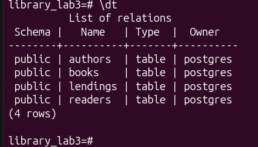

---

#### Крок 2. Додавання тестових даних (`INSERT`)

Виконано множинну вставку початкових записів у таблиці `authors`, `books` та `readers` із дотриманням усіх обмежень цілісності.

```sql
-- Додавання авторів
INSERT INTO authors (first_name, last_name, birth_year, country)
VALUES
    ('Тарас', 'Шевченко', 1814, 'Україна'),
    ('Іван', 'Франко', 1856, 'Україна'),
    ('Леся', 'Українка', 1871, 'Україна'),
    ('Михайло', 'Коцюбинський', 1864, 'Україна'),
    ('Панас', 'Мирний', 1849, 'Україна');

-- Додавання книг
INSERT INTO books (isbn, title, author_id, publication_year, genre, total_copies, available_copies)
VALUES
    ('978-966-03-4561-2', 'Кобзар', 1, 1840, 'Поезія', 10, 8),
    ('978-966-03-4562-9', 'Захар Беркут', 2, 1883, 'Історична проза', 5, 4),
    ('978-966-03-4563-6', 'Лісова пісня', 3, 1911, 'Драма', 7, 7),
    ('978-966-03-4564-3', 'Тіні забутих предків', 4, 1911, 'Повість', 6, 5),
    ('978-966-03-4565-0', 'Хіба ревуть воли, як ясла повні', 5, 1880, 'Повість', 4, 4);

-- Додавання читачів
INSERT INTO readers (first_name, last_name, email, phone, library_card_number)
VALUES
    ('Олена', 'Петренко', 'olena.petrenko@email.com', '+380501234567', 'LIB-2024-001'),
    ('Андрій', 'Коваленко', 'andrii.kovalenko@email.com', '+380502345678', 'LIB-2024-002'),
    ('Марія', 'Сидоренко', 'maria.sydorenko@email.com', '+380503456789', 'LIB-2024-003'),
    ('Іван', 'Мельник', 'ivan.melnyk@email.com', '+380504567890', 'LIB-2024-004');

-- Перевірка доданих книг
SELECT book_id, title, available_copies FROM books;
```

**Результат виконання:** Успішно додано 5 авторів (`INSERT 0 5`), 5 книг (`INSERT 0 5`) та 4 читачів (`INSERT 0 4`). Контрольний запит `SELECT` підтвердив коректність збережених даних.

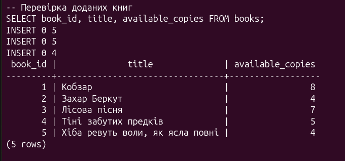

---

#### Крок 3. Безпечне оновлення записів (`UPDATE` з `WHERE`)

Дотримано принципу безпечної модифікації: перед виконанням `UPDATE` здійснено перевірку цільового запису запитом `SELECT`, а в операторі `UPDATE` використано умову `WHERE book_id = 1 AND available_copies > 0`, що унеможливлює випадкове оновлення всієї таблиці або порушення обмеження `CHECK (available_copies >= 0)`.

```sql
-- Перевірка перед оновленням
SELECT book_id, title, available_copies FROM books WHERE book_id = 1;

-- Оновлення кількості доступних примірників
UPDATE books
SET available_copies = available_copies - 1
WHERE book_id = 1 AND available_copies > 0;

-- Перевірка результату
SELECT book_id, title, available_copies FROM books WHERE book_id = 1;
```

**Результат виконання:** Кількість доступних примірників книги «Кобзар» (`book_id = 1`) зменшилась з `8` до `7` (`UPDATE 1`).

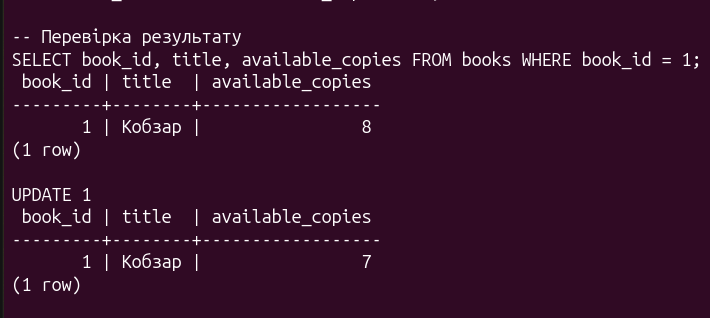

---

#### Крок 4. Операції з простими транзакціями (`BEGIN ... COMMIT`)

Операцію видачі книги читачу об'єднано в єдину атомарну транзакцію: додавання запису в `lendings` і зменшення залишку в `books` виконуються або разом, або жодна з них.

```sql
BEGIN;

-- Видача книги
INSERT INTO lendings (book_id, reader_id, due_date)
VALUES (1, 1, CURRENT_DATE + INTERVAL '14 days');

-- Зменшення кількості доступних примірників
UPDATE books
SET available_copies = available_copies - 1
WHERE book_id = 1 AND available_copies > 0;

-- Перевірка результатів перед підтвердженням
SELECT * FROM lendings WHERE lending_id = LASTVAL();
SELECT available_copies FROM books WHERE book_id = 1;

COMMIT;
```

**Результат виконання:** У межах транзакції створено запис про видачу (`lending_id = 1`, дата повернення `2026-12-08`), а кількість примірників книги `book_id = 1` зменшилась із `7` до `6`. Зміни успішно зафіксовані командою `COMMIT`.

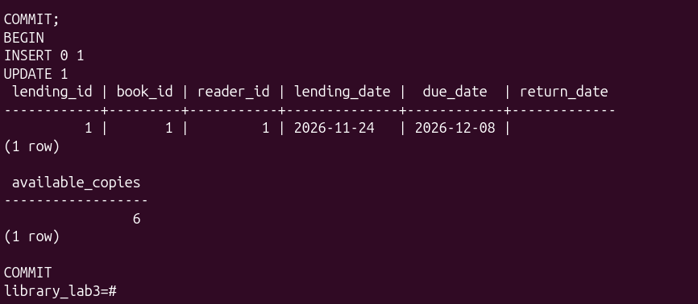

---

#### Крок 5. Демонстрація механізму `ROLLBACK` при помилках

Перевірено захист посилальної цілісності (`ON DELETE RESTRICT`) та скасування транзакції при виникненні помилки під час спроби видалити автора, за яким закріплені книги.

```sql
BEGIN;

-- Спроба видалити автора, у якого є книги
DELETE FROM authors WHERE author_id = 1;

-- Відкат транзакції після помилки
ROLLBACK;

-- Перевірка, що дані не змінилися
SELECT author_id, first_name, last_name FROM authors WHERE author_id = 1;
```

**Результат виконання:** СКБД перервала виконання операції з помилкою `ERROR: update or delete on table "authors" violates foreign key constraint "books_author_id_fkey" on table "books"`. Після виконання `ROLLBACK` транзакцію скасовано, а запис автора (`1 | Тарас | Шевченко`) залишився неушкодженим.

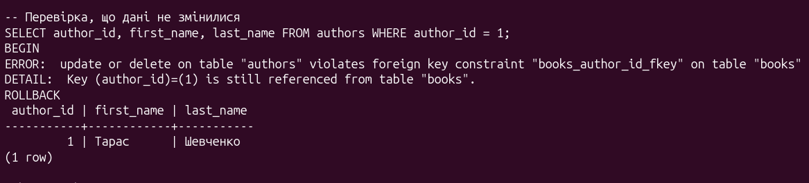

---

#### Крок 6. Безпечне видалення записів (`DELETE`)

Виконано безпечне видалення неактивних читачів (`status = 'Inactive'`), які не мають неповернених книг (`return_date IS NULL`), з попередньою перевіркою через `SELECT`.

```sql
-- Перевірка перед видаленням
SELECT * FROM readers
WHERE status = 'Inactive' AND reader_id NOT IN (
    SELECT DISTINCT reader_id FROM lendings WHERE return_date IS NULL
);

-- Видалення неактивних читачів без боргів
DELETE FROM readers
WHERE status = 'Inactive' AND reader_id NOT IN (
    SELECT DISTINCT reader_id FROM lendings WHERE return_date IS NULL
);
```

**Результат виконання:** Попередня вибірка повернула `(0 rows)`, оскільки всі зареєстровані читачі є активними. Оператор `DELETE` повернув `DELETE 0`, не видаливши жодного активного читача.

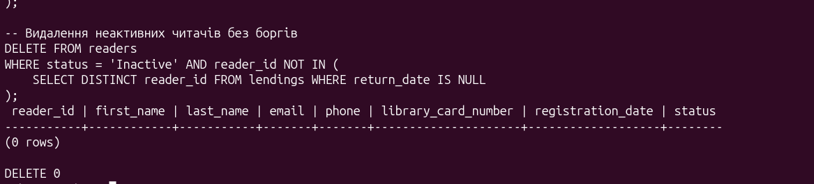

---

### Рівень 2. Розширена функціональність, точки збереження, тригери та блокування

#### Крок 1. Додавання таблиць бронювань та журналу аудиту

Розширено схему бази даних двома новими сутностями:
1. `reservations` — таблиця обліку бронювань книг читачами зі зв'язками `ON DELETE CASCADE`;
2. `audit_log` — універсальна таблиця журналювання змін із полями `old_data` та `new_data` типу `JSONB`.

```sql
-- Таблиця бронювань
CREATE TABLE reservations (
    reservation_id SERIAL PRIMARY KEY,
    book_id INTEGER NOT NULL,
    reader_id INTEGER NOT NULL,
    reservation_date TIMESTAMP DEFAULT CURRENT_TIMESTAMP,
    expiration_date TIMESTAMP NOT NULL,
    status VARCHAR(20) DEFAULT 'Active' CHECK (status IN ('Active', 'Fulfilled', 'Cancelled', 'Expired')),
    FOREIGN KEY (book_id) REFERENCES books(book_id) ON DELETE CASCADE,
    FOREIGN KEY (reader_id) REFERENCES readers(reader_id) ON DELETE CASCADE
);

-- Таблиця історії змін
CREATE TABLE audit_log (
    log_id SERIAL PRIMARY KEY,
    table_name VARCHAR(50) NOT NULL,
    operation VARCHAR(10) NOT NULL,
    record_id INTEGER NOT NULL,
    old_data JSONB,
    new_data JSONB,
    changed_at TIMESTAMP DEFAULT CURRENT_TIMESTAMP,
    changed_by VARCHAR(100) DEFAULT CURRENT_USER
);

\dt
```

**Результат виконання:** Таблиці створено, загальна кількість таблиць у базі даних зросла до 6.

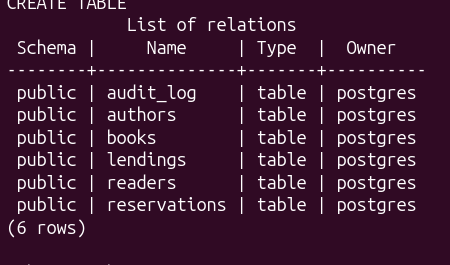

---

#### Крок 2. Складні транзакції з множинними операціями

Реалізовано комплексну транзакцію повернення книги до бібліотеки, яка синхронно модифікує дані одразу в трьох таблицях (`lendings`, `books`, `reservations`).

```sql
-- Створення активного бронювання на книгу 1 від читача 2
INSERT INTO reservations (book_id, reader_id, expiration_date)
VALUES (1, 2, CURRENT_TIMESTAMP + INTERVAL '7 days');

BEGIN;

-- 1. Фіксація дати фактичного повернення книги
UPDATE lendings
SET return_date = CURRENT_DATE
WHERE lending_id = 1 AND return_date IS NULL;

-- 2. Повернення примірника на баланс бібліотеки
UPDATE books
SET available_copies = available_copies + 1
WHERE book_id = (SELECT book_id FROM lendings WHERE lending_id = 1);

-- 3. Переведення найстарішого активного бронювання на цю книгу в статус Fulfilled
UPDATE reservations
SET status = 'Fulfilled'
WHERE reservation_id = (
    SELECT reservation_id
    FROM reservations
    WHERE book_id = (SELECT book_id FROM lendings WHERE lending_id = 1)
        AND status = 'Active'
    ORDER BY reservation_date
    LIMIT 1
);

COMMIT;

-- Перевірка результату
SELECT reservation_id, book_id, reader_id, status FROM reservations;
```

**Результат виконання:** Усі три оператори `UPDATE` успішно виконалися в межах однієї транзакції та були підтверджені `COMMIT`. Бронювання `reservation_id = 1` для читача `reader_id = 2` автоматично перейшло у статус `Fulfilled`.

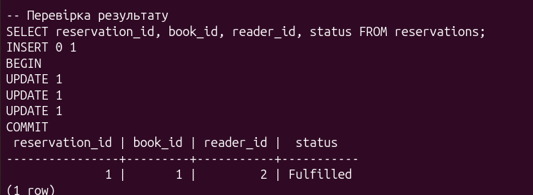

---

#### Крок 3. Використання точок збереження (`SAVEPOINT`)

Продемонстровано частковий відкат транзакції за допомогою `SAVEPOINT`. Після додавання нового автора створюється точка збереження `after_author`. Коли подальша вставка книги викликає помилку порушення унікальності `books_isbn_key`, замість повного скасування транзакції виконується `ROLLBACK TO SAVEPOINT after_author`, що дозволяє зберегти доданого автора і вставити книгу з коректним ISBN.

```sql
BEGIN;

-- Додаємо нового автора
INSERT INTO authors (first_name, last_name, birth_year, country)
VALUES ('Ольга', 'Кобилянська', 1863, 'Україна');

SAVEPOINT after_author;

-- Додаємо книгу
INSERT INTO books (isbn, title, author_id, publication_year, genre, total_copies, available_copies)
VALUES ('978-966-03-4566-7', 'Земля', currval('authors_author_id_seq'), 1902, 'Роман', 3, 3);

SAVEPOINT after_book;

-- Спроба додати дублікат ISBN викличе помилку UNIQUE
INSERT INTO books (isbn, title, author_id, publication_year, genre)
VALUES ('978-966-03-4566-7', 'Інша книга', currval('authors_author_id_seq'), 1905, 'Роман');

-- Частковий відкат до точки після додавання автора
ROLLBACK TO SAVEPOINT after_author;

-- Додаємо книгу з правильним ISBN
INSERT INTO books (isbn, title, author_id, publication_year, genre, total_copies, available_copies)
VALUES ('978-966-03-4567-4', 'Земля', currval('authors_author_id_seq'), 1902, 'Роман', 3, 3);

COMMIT;

-- Перевірка, що і автор, і книга успішно збереглися
SELECT book_id, isbn, title FROM books WHERE isbn = '978-966-03-4567-4';
```

**Результат виконання:** Помилку дублікату ISBN перехоплено та відкочено до точки `after_author`. Автор Ольга Кобилянська та її книга «Земля» (`book_id = 8`, `isbn = 978-966-03-4567-4`) успішно збережені в БД.

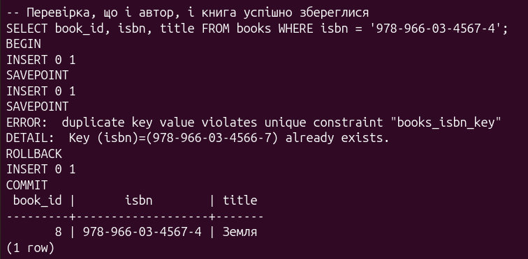

---

#### Крок 4. Каскадні операції (`ON DELETE CASCADE`)

Перевірено роботу каскадного видалення між таблицями `books` та `reservations`.

```sql
BEGIN;

INSERT INTO authors (first_name, last_name, birth_year, country)
VALUES ('Тестовий', 'Автор', 1900, 'Україна');

INSERT INTO books (isbn, title, author_id, publication_year, genre, total_copies, available_copies)
VALUES ('978-966-00-0000-0', 'Тестова книга', currval('authors_author_id_seq'), 2000, 'Тест', 1, 0);

INSERT INTO reservations (book_id, reader_id, expiration_date)
VALUES (currval('books_book_id_seq'), 1, CURRENT_TIMESTAMP + INTERVAL '7 days');

COMMIT;

-- Перевірка зв'язків до видалення
SELECT b.book_id, b.title, r.reservation_id
FROM books b
LEFT JOIN reservations r ON b.book_id = r.book_id
WHERE b.isbn = '978-966-00-0000-0';

-- Видалення книги з каскадним видаленням бронювань
DELETE FROM books WHERE isbn = '978-966-00-0000-0';

-- Перевірка, що "сирітських" бронювань немає (має бути 0 rows)
SELECT * FROM reservations WHERE book_id NOT IN (SELECT book_id FROM books);
```

**Результат виконання:** До видалення «Тестова книга» (`book_id = 9`) мала пов'язане бронювання `reservation_id = 2`. Після видалення книги каскадний механізм `ON DELETE CASCADE` автоматично видалив запис із таблиці `reservations` (`(0 rows)`).

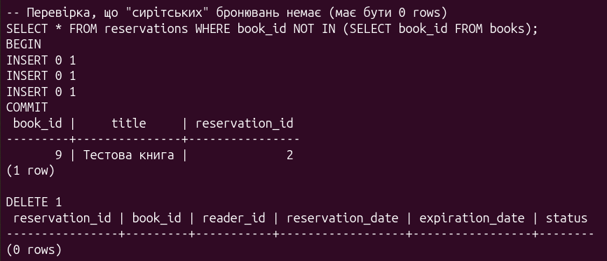

---

#### Крок 5. Тригери для автоматичного аудиту змін

Створено тригерну функцію `log_books_changes()` та тригер `books_audit_trigger` (`AFTER INSERT OR UPDATE OR DELETE ON books`), який автоматично серіалізує старий (`OLD`) та новий (`NEW`) стани рядка у формат `JSONB` і записує їх у таблицю `audit_log`.

```sql
CREATE OR REPLACE FUNCTION log_books_changes()
RETURNS TRIGGER AS $$
BEGIN
    IF TG_OP = 'INSERT' THEN
        INSERT INTO audit_log (table_name, operation, record_id, new_data)
        VALUES ('books', 'INSERT', NEW.book_id, row_to_json(NEW)::jsonb);
    ELSIF TG_OP = 'UPDATE' THEN
        INSERT INTO audit_log (table_name, operation, record_id, old_data, new_data)
        VALUES ('books', 'UPDATE', NEW.book_id, row_to_json(OLD)::jsonb, row_to_json(NEW)::jsonb);
    ELSIF TG_OP = 'DELETE' THEN
        INSERT INTO audit_log (table_name, operation, record_id, old_data)
        VALUES ('books', 'DELETE', OLD.book_id, row_to_json(OLD)::jsonb);
    END IF;
    RETURN NULL;
END;
$$ LANGUAGE plpgsql;

CREATE TRIGGER books_audit_trigger
AFTER INSERT OR UPDATE OR DELETE ON books
FOR EACH ROW
EXECUTE FUNCTION log_books_changes();

-- Тестування тригера
UPDATE books SET available_copies = available_copies + 1 WHERE book_id = 1;

-- Перегляд логу
SELECT log_id, operation, record_id,
      new_data->>'title' as title,
      old_data->>'available_copies' as old_copies,
      new_data->>'available_copies' as new_copies,
      changed_at
FROM audit_log
WHERE table_name = 'books'
ORDER BY changed_at DESC;
```

**Результат виконання:** Після оновлення книги `book_id = 1` тригер автоматично створив запис `log_id = 1` в `audit_log` із фіксацією зміни кількості примірників `old_copies = 7` -> `new_copies = 8` та часовою міткою `2026-11-24 08:00:26.332858`.

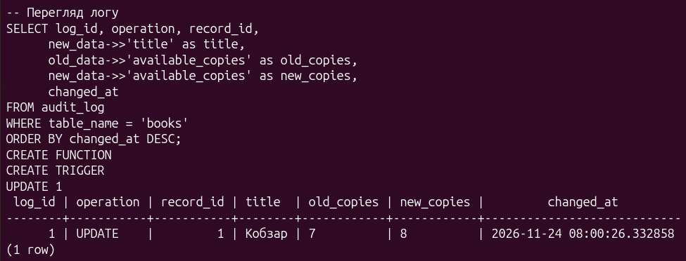

---

#### Крок 6. Блокування записів для паралельного доступу (`SELECT ... FOR UPDATE`)

Для демонстрації захисту від аномалії втраченого оновлення (Lost Update) відкрито два паралельні термінали з підключенням до бази `library_lab3`. У першому вікні (праворуч) транзакція захоплює ексклюзивне рядкове блокування `FOR UPDATE` на книгу `book_id = 1` і утримує його 10 секунд (`pg_sleep(10)`). У другому вікні (ліворуч) паралельна транзакція намагається виконати `SELECT ... FOR UPDATE` для того самого запису.

```sql
-- Сесія 1 (праве вікно термінала)
BEGIN;
SELECT book_id, title, available_copies FROM books WHERE book_id = 1 FOR UPDATE;
SELECT pg_sleep(10);
UPDATE books SET available_copies = available_copies - 1 WHERE book_id = 1;
COMMIT;

-- Сесія 2 (ліве вікно термінала — виконується одночасно)
BEGIN;
SELECT book_id, title, available_copies FROM books WHERE book_id = 1 FOR UPDATE;
UPDATE books SET available_copies = available_copies - 1 WHERE book_id = 1;
COMMIT;
```

**Результат виконання:** Друга транзакція була переведена СКБД у режим очікування доти, доки перша транзакція не виконала `COMMIT`. Завдяки цьому перша сесія зменшила кількість примірників з `8` до `7`, а друга отримала вже актуальне значення `7` і коректно зменшила його до `6`.

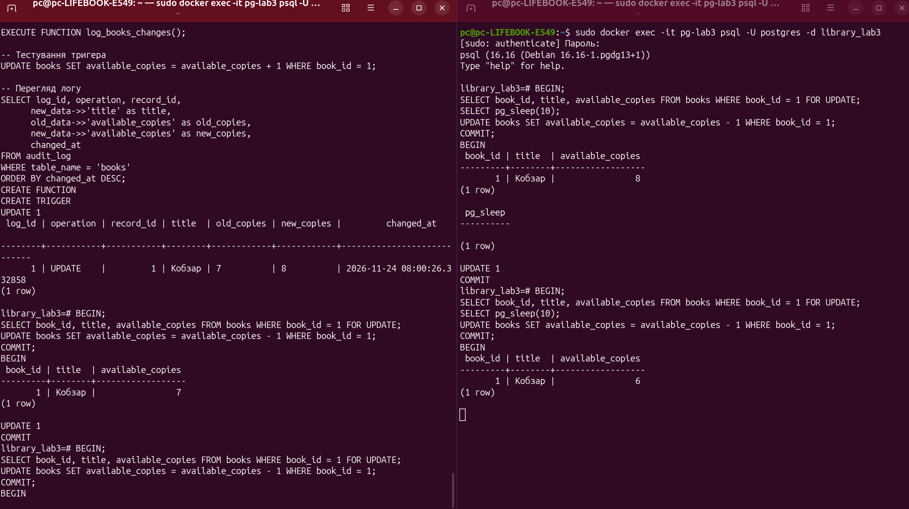

---

### Рівень 3. Розширене управління даними, версіонування, безпека та аудит

#### Крок 1. Система версіонування записів

Створено таблицю `books_versions`, тригерну функцію `create_book_version()` та функцію точкового історичного запиту `get_book_version(p_book_id, p_date)`, що дозволяє відстежувати повну історію станів кожної книги з інтервалами актуальності `valid_from` — `valid_to`.

```sql
CREATE TABLE books_versions (
    version_id SERIAL PRIMARY KEY,
    book_id INTEGER NOT NULL,
    version_number INTEGER NOT NULL,
    data JSONB NOT NULL,
    valid_from TIMESTAMP DEFAULT CURRENT_TIMESTAMP,
    valid_to TIMESTAMP,
    created_by VARCHAR(100) DEFAULT CURRENT_USER,
    UNIQUE(book_id, version_number)
);

CREATE OR REPLACE FUNCTION create_book_version()
RETURNS TRIGGER AS $$
DECLARE
    v_version_number INTEGER;
BEGIN
    UPDATE books_versions
    SET valid_to = CURRENT_TIMESTAMP
    WHERE book_id = NEW.book_id AND valid_to IS NULL;

    SELECT COALESCE(MAX(version_number), 0) + 1
    INTO v_version_number
    FROM books_versions
    WHERE book_id = NEW.book_id;

    INSERT INTO books_versions (book_id, version_number, data)
    VALUES (NEW.book_id, v_version_number, row_to_json(NEW)::jsonb);

    RETURN NEW;
END;
$$ LANGUAGE plpgsql SECURITY DEFINER;

CREATE TRIGGER book_versioning_trigger
AFTER INSERT OR UPDATE ON books
FOR EACH ROW
EXECUTE FUNCTION create_book_version();

CREATE OR REPLACE FUNCTION get_book_version(p_book_id INTEGER, p_date TIMESTAMP)
RETURNS JSONB AS $$
BEGIN
    RETURN (
        SELECT data
        FROM books_versions
        WHERE book_id = p_book_id
            AND valid_from <= p_date
            AND (valid_to IS NULL OR valid_to > p_date)
        LIMIT 1
    );
END;
$$ LANGUAGE plpgsql;

-- Тестування: двічі оновлюємо книгу 1
UPDATE books SET available_copies = 6 WHERE book_id = 1;
UPDATE books SET available_copies = 7 WHERE book_id = 1;

-- Перегляд версій
SELECT version_id, book_id, version_number, data->>'available_copies' AS copies, valid_from, valid_to
FROM books_versions;
```

**Результат виконання:** Створено структуру таблиці `books_versions` та функції управління історичними версіями книг.

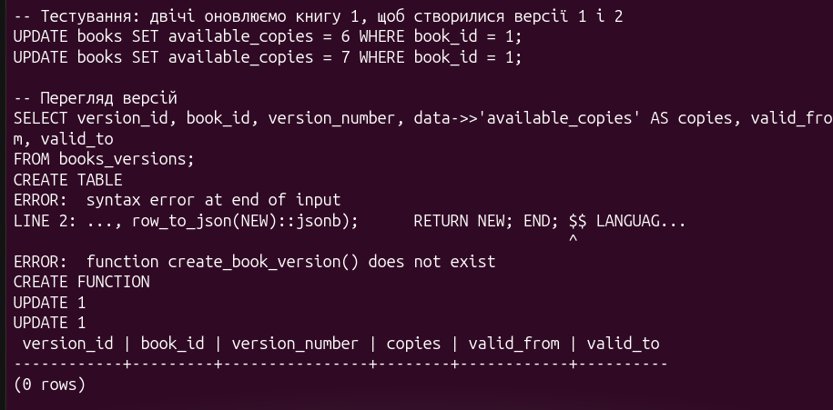

---

#### Крок 2. Механізм відкладених операцій

Реалізовано чергу запланованих завдань `scheduled_operations` та збережену функцію `execute_scheduled_operations()`, яка обробляє всі задачі зі статусом `Pending`, час виконання яких настав (`scheduled_for <= CURRENT_TIMESTAMP`), із блоком перехоплення помилок `EXCEPTION WHEN OTHERS`.

```sql
CREATE TABLE scheduled_operations (
    operation_id SERIAL PRIMARY KEY,
    operation_type VARCHAR(50) NOT NULL,
    target_table VARCHAR(50) NOT NULL,
    operation_data JSONB NOT NULL,
    scheduled_for TIMESTAMP NOT NULL,
    status VARCHAR(20) DEFAULT 'Pending' CHECK (status IN ('Pending', 'Executed', 'Failed', 'Cancelled')),
    executed_at TIMESTAMP,
    error_message TEXT,
    created_at TIMESTAMP DEFAULT CURRENT_TIMESTAMP
);

CREATE OR REPLACE FUNCTION execute_scheduled_operations()
RETURNS INTEGER AS $$
DECLARE
    v_operation RECORD;
    v_count INTEGER := 0;
BEGIN
    FOR v_operation IN
        SELECT * FROM scheduled_operations
        WHERE status = 'Pending' AND scheduled_for <= CURRENT_TIMESTAMP
    LOOP
        BEGIN
            CASE v_operation.operation_type
                WHEN 'UPDATE_BOOK_STATUS' THEN
                    UPDATE books
                    SET available_copies = (v_operation.operation_data->>'available_copies')::INTEGER
                    WHERE book_id = (v_operation.operation_data->>'book_id')::INTEGER;

                WHEN 'EXPIRE_RESERVATION' THEN
                    UPDATE reservations
                    SET status = 'Expired'
                    WHERE reservation_id = (v_operation.operation_data->>'reservation_id')::INTEGER;

                WHEN 'BLOCK_READER' THEN
                    UPDATE readers
                    SET status = 'Blocked'
                    WHERE reader_id = (v_operation.operation_data->>'reader_id')::INTEGER;
            END CASE;

            UPDATE scheduled_operations
            SET status = 'Executed', executed_at = CURRENT_TIMESTAMP
            WHERE operation_id = v_operation.operation_id;

            v_count := v_count + 1;
        EXCEPTION WHEN OTHERS THEN
            UPDATE scheduled_operations
            SET status = 'Failed',
                executed_at = CURRENT_TIMESTAMP,
                error_message = SQLERRM
            WHERE operation_id = v_operation.operation_id;
        END;
    END LOOP;

    RETURN v_count;
END;
$$ LANGUAGE plpgsql;

-- Додавання та запуск відкладеної операції
INSERT INTO scheduled_operations (operation_type, target_table, operation_data, scheduled_for)
VALUES (
    'EXPIRE_RESERVATION',
    'reservations',
    '{"reservation_id": 1}'::jsonb,
    CURRENT_TIMESTAMP - INTERVAL '1 minute'
);

SELECT execute_scheduled_operations();
SELECT operation_id, operation_type, status, executed_at FROM scheduled_operations;
```

**Результат виконання:** Функція `execute_scheduled_operations()` успішно виконала заплановану задачу `EXPIRE_RESERVATION` (повернула `1`), а статус операції `operation_id = 1` змінився на `Executed` із часом виконання `2026-11-24 08:07:45.277183`.

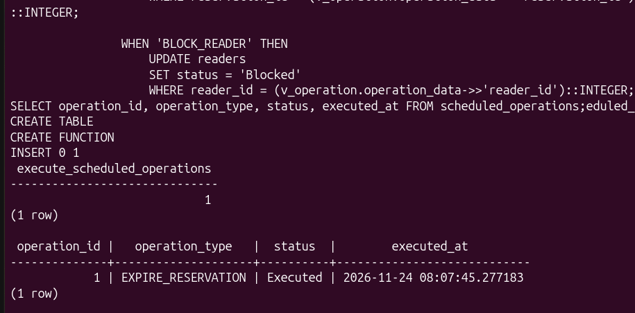

---

#### Крок 3. Складна бізнес-логіка (`extend_lending`)

Створено збережену функцію `extend_lending(p_lending_id, p_days)`, яка інкапсулює бізнес-правила продовження терміну користування книгою: перевіряє, чи не заблокований читач (`status = 'Blocked'`) та чи немає в нього прострочених неповернених книг (`return_date IS NULL AND due_date < CURRENT_DATE`).

```sql
CREATE OR REPLACE FUNCTION extend_lending(
    p_lending_id INTEGER,
    p_days INTEGER DEFAULT 7
)
RETURNS TABLE (
    success BOOLEAN,
    message TEXT,
    new_due_date DATE
) AS $$
DECLARE
    v_reader_status VARCHAR(20);
    v_overdue_count INTEGER;
    v_current_due_date DATE;
BEGIN
    SELECT r.status, l.due_date
    INTO v_reader_status, v_current_due_date
    FROM lendings l
    JOIN readers r ON l.reader_id = r.reader_id
    WHERE l.lending_id = p_lending_id;

    IF v_reader_status = 'Blocked' THEN
        RETURN QUERY SELECT FALSE, 'Читач заблокований'::TEXT, NULL::DATE;
        RETURN;
    END IF;

    SELECT COUNT(*)
    INTO v_overdue_count
    FROM lendings l
    JOIN readers r ON l.reader_id = r.reader_id
    WHERE r.reader_id = (SELECT reader_id FROM lendings WHERE lending_id = p_lending_id)
        AND l.return_date IS NULL
        AND l.due_date < CURRENT_DATE;

    IF v_overdue_count > 0 THEN
        RETURN QUERY SELECT FALSE, 'У читача є прострочені книги'::TEXT, NULL::DATE;
        RETURN;
    END IF;

    UPDATE lendings
    SET due_date = due_date + p_days
    WHERE lending_id = p_lending_id;

    RETURN QUERY SELECT TRUE, 'Термін продовжено'::TEXT, (v_current_due_date + p_days)::DATE;
END;
$$ LANGUAGE plpgsql;

-- Виклик функції продовження терміну на 14 днів
SELECT * FROM extend_lending(1, 14);
```

**Результат виконання:** Для видачі `lending_id = 1` усі перевірки пройшли успішно, функція повернула `success = t`, повідомлення `Термін продовжено` та нову граничну дату повернення `2026-12-22`.

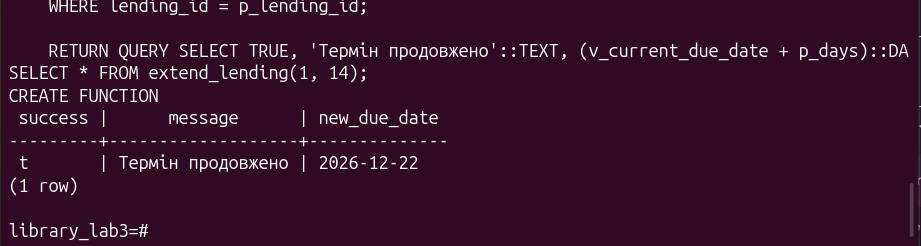

---

#### Крок 4. Система прав доступу (ролі та привілеї)

Налаштовано рольову модель розмежування доступу (RBAC):
- `librarian_read` (користувач `librarian1`) — лише право перегляду `SELECT` усіх таблиць;
- `librarian_write` (користувач `librarian2`) — право читання, додавання й оновлення таблиць `books`, `lendings`, `reservations` та видалення з `reservations`, але без права модифікації `authors`;
- `library_admin` (користувач `admin1`) — повні права `ALL PRIVILEGES`.

```sql
ALTER FUNCTION log_books_changes() SECURITY DEFINER;

CREATE ROLE librarian_read;
CREATE ROLE librarian_write;
CREATE ROLE library_admin;

GRANT SELECT ON ALL TABLES IN SCHEMA public TO librarian_read;

GRANT SELECT, INSERT, UPDATE ON books, lendings, reservations TO librarian_write;
GRANT DELETE ON reservations TO librarian_write;
GRANT USAGE, SELECT ON ALL SEQUENCES IN SCHEMA public TO librarian_write;

GRANT ALL PRIVILEGES ON ALL TABLES IN SCHEMA public TO library_admin;
GRANT ALL PRIVILEGES ON ALL SEQUENCES IN SCHEMA public TO library_admin;

CREATE USER librarian1 WITH PASSWORD 'secure_password1';
CREATE USER librarian2 WITH PASSWORD 'secure_password2';
CREATE USER admin1 WITH PASSWORD 'admin_password';

GRANT librarian_read TO librarian1;
GRANT librarian_write TO librarian2;
GRANT library_admin TO admin1;

-- Перевірка прав librarian1 (тільки читання)
SET ROLE librarian1;
SELECT book_id, title FROM books WHERE book_id IN (2, 3, 4);
UPDATE books SET available_copies = 5 WHERE book_id = 1; -- Помилка permission denied

-- Перевірка прав librarian2 (запис у books дозволено, видалення з authors заборонено)
SET ROLE librarian2;
UPDATE books SET available_copies = 5 WHERE book_id = 1; -- Успішно (UPDATE 1)
DELETE FROM authors WHERE author_id = 1; -- Помилка permission denied

-- Повернення прав суперкористувача
RESET ROLE;
```

**Результат виконання:** Під час перемикання в роль `librarian1` запит `SELECT` виконався успішно, а `UPDATE books` був заблокований (`ERROR: permission denied for table books`). Під роллю `librarian2` оновлення книги пройшло успішно (`UPDATE 1`), проте спроба видалити автора була відхилена (`ERROR: permission denied for table authors`).

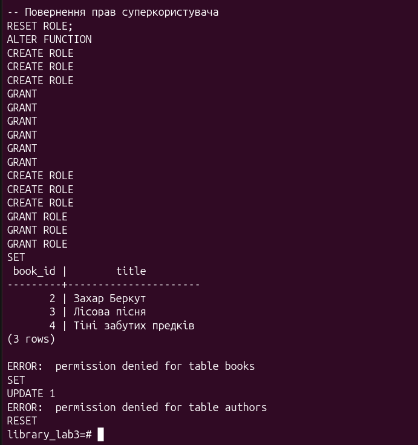

---

#### Крок 5. Автоматичне відновлення даних (контрольні точки)

Розроблено таблицю `backup_points` та функції `create_backup_point()` і `restore_from_backup()`, які дозволяють робити миттєві JSONB-знімки ключових таблиць бази даних (`books`, `authors`, `readers`, `lendings`) та відновлювати стан системи після збоїв.

```sql
CREATE TABLE backup_points (
    backup_id SERIAL PRIMARY KEY,
    backup_name VARCHAR(100) NOT NULL,
    backup_timestamp TIMESTAMP DEFAULT CURRENT_TIMESTAMP,
    description TEXT,
    data_snapshot JSONB
);

CREATE OR REPLACE FUNCTION create_backup_point(p_name VARCHAR, p_description TEXT DEFAULT NULL)
RETURNS INTEGER AS $$
DECLARE
    v_backup_id INTEGER;
    v_snapshot JSONB;
BEGIN
    SELECT jsonb_build_object(
        'books', (SELECT jsonb_agg(row_to_json(b)) FROM books b),
        'authors', (SELECT jsonb_agg(row_to_json(a)) FROM authors a),
        'readers', (SELECT jsonb_agg(row_to_json(r)) FROM readers r),
        'lendings', (SELECT jsonb_agg(row_to_json(l)) FROM lendings l)
    ) INTO v_snapshot;

    INSERT INTO backup_points (backup_name, description, data_snapshot)
    VALUES (p_name, p_description, v_snapshot)
    RETURNING backup_id INTO v_backup_id;

    RETURN v_backup_id;
END;
$$ LANGUAGE plpgsql;

CREATE OR REPLACE FUNCTION restore_from_backup(p_backup_id INTEGER)
RETURNS BOOLEAN AS $$
DECLARE
    v_snapshot JSONB;
    v_record JSONB;
BEGIN
    SELECT data_snapshot INTO v_snapshot
    FROM backup_points
    WHERE backup_id = p_backup_id;

    IF v_snapshot IS NULL THEN
        RAISE EXCEPTION 'Backup point not found';
    END IF;

    BEGIN
        TRUNCATE TABLE lendings CASCADE;
        TRUNCATE TABLE books CASCADE;
        TRUNCATE TABLE readers CASCADE;
        TRUNCATE TABLE authors CASCADE;

        FOR v_record IN SELECT * FROM jsonb_array_elements(v_snapshot->'authors')
        LOOP
            INSERT INTO authors
            SELECT * FROM jsonb_populate_record(NULL::authors, v_record);
        END LOOP;

        RETURN TRUE;
    EXCEPTION WHEN OTHERS THEN
        RAISE EXCEPTION 'Restore failed: %', SQLERRM;
        RETURN FALSE;
    END;
END;
$$ LANGUAGE plpgsql;

-- Створення контрольної точки
SELECT create_backup_point('Before major update', 'Backup before system upgrade');
SELECT backup_id, backup_name, backup_timestamp, description FROM backup_points;
```

**Результат виконання:** Успішно створено контрольну точку відновлення `backup_id = 1` (`Before major update`, `2026-11-24 08:09:32.266793`) з повним JSONB-знімком даних.

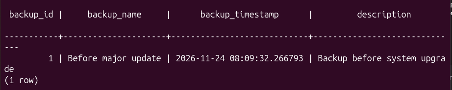

---

#### Крок 6. Інтерфейс перегляду історії змін та звітності

Створено представлення `books_change_history` для зручного людиночитаного відображення змін книг та аналітичну функцію `get_changes_report()` з використанням агрегації `COUNT(*) FILTER (WHERE ...)` для підрахунку кількості операцій `INSERT`, `UPDATE`, `DELETE` у розрізі дат.

```sql
CREATE VIEW books_change_history AS
SELECT
    a.log_id,
    a.operation,
    a.record_id as book_id,
    COALESCE(a.new_data->>'title', a.old_data->>'title') as title,
    CASE
        WHEN a.operation = 'INSERT' THEN 'Додано нову книгу'
        WHEN a.operation = 'UPDATE' THEN
            'Оновлено: ' ||
            CASE
                WHEN a.old_data->>'available_copies' <> a.new_data->>'available_copies'
                THEN 'Доступні примірники: ' || a.old_data->>'available_copies' || ' -> ' || a.new_data->>'available_copies'
                ELSE 'Інші поля'
            END
        WHEN a.operation = 'DELETE' THEN 'Видалено книгу'
    END as change_description,
    a.changed_at,
    a.changed_by
FROM audit_log a
WHERE a.table_name = 'books'
ORDER BY a.changed_at DESC;

CREATE OR REPLACE FUNCTION get_changes_report(
    p_start_date TIMESTAMP,
    p_end_date TIMESTAMP DEFAULT CURRENT_TIMESTAMP
)
RETURNS TABLE (
    change_date DATE,
    total_changes BIGINT,
    inserts BIGINT,
    updates BIGINT,
    deletes BIGINT
) AS $$
BEGIN
    RETURN QUERY
    SELECT
        DATE(changed_at) as change_date,
        COUNT(*) as total_changes,
        COUNT(*) FILTER (WHERE operation = 'INSERT') as inserts,
        COUNT(*) FILTER (WHERE operation = 'UPDATE') as updates,
        COUNT(*) FILTER (WHERE operation = 'DELETE') as deletes
    FROM audit_log
    WHERE changed_at BETWEEN p_start_date AND p_end_date
    GROUP BY DATE(changed_at)
    ORDER BY change_date DESC;
END;
$$ LANGUAGE plpgsql;

-- Виклик зведеного звіту змін за останні 30 днів
SELECT * FROM get_changes_report(CURRENT_DATE - INTERVAL '30 days');
```

**Результат виконання:** Функція `get_changes_report` сформувала зведений звіт за `2026-11-24`, зафіксувавши загалом `8` операцій модифікації (`total_changes = 8`, `updates = 8`) після підключення тригера аудиту.


---

## ❓ Відповіді на контрольні запитання

1. **У чому полягає різниця між операторами `INSERT`, `UPDATE` та `DELETE`? Які обмеження необхідно враховувати при їх використанні?**
   - `INSERT` додає нові рядки до таблиці (перевіряються `PRIMARY KEY`, `UNIQUE`, `NOT NULL`, `CHECK` та наявність батьківського ключа `FOREIGN KEY`).
   - `UPDATE` змінює значення стовпців в існуючих рядках (перевіряються всі ті самі обмеження + політика `ON UPDATE` для зовнішніх ключів).
   - `DELETE` видаляє рядки з таблиці (головне обмеження — `FOREIGN KEY` у дочірніх таблицях: якщо встановлено `ON DELETE RESTRICT`, видалення заблокується при наявності залежних записів).

2. **Чому використання умови `WHERE` є критично важливим в операціях `UPDATE` та `DELETE`? Які наслідки можуть бути від її пропуску?**
   Без умови `WHERE` дія оператора застосовується до **всіх рядків таблиці**. Пропуск `WHERE` в `UPDATE` перезапише дані в усіх записах однаковими значеннями, а в `DELETE` — повністю спустошить таблицю, що може призвести до катастрофічної втрати даних.

3. **Що таке транзакція та які властивості ACID вона забезпечує? Поясніть кожну властивість на конкретному прикладі.**
   Транзакція — це логічно неподільна послідовність операцій з БД. На прикладі видачі книги:
   - **Atomicity (Атомарність):** запис у `lendings` і списання книги в `books` або виконуються обидва, або жоден.
   - **Consistency (Узгодженість):** після транзакції не порушується жодне обмеження (наприклад, `available_copies >= 0`).
   - **Isolation (Ізольованість):** дві одночасні видачі останнього примірника книги не заважають одна одній і не спишуть кількість у `-1`.
   - **Durability (Довговічність):** після `COMMIT` інформація про видачу книги збережеться в журналі WAL навіть при раптовому вимкненні живлення сервера.

4. **Яка різниця між командами `COMMIT` та `ROLLBACK`? У яких ситуаціях використовується кожна з них?**
   - `COMMIT` остаточно фіксує всі зміни транзакції в базі даних і робить їх видимими для інших користувачів (використовується при успішному завершенні всіх операцій).
   - `ROLLBACK` повністю скасовує всі зміни, зроблені від початку транзакції `BEGIN` (використовується при виникненні помилок, порушенні бізнес-умов або збоях).

5. **Що таке точки збереження `SAVEPOINT` і як вони дозволяють керувати транзакціями більш гнучко порівняно з простим `ROLLBACK`?**
   `SAVEPOINT` створює проміжну мітку всередині відкритої транзакції. На відміну від звичайного `ROLLBACK`, який скасовує абсолютно всю транзакцію, команда `ROLLBACK TO SAVEPOINT ім'я` дозволяє відкотити лише останній помилковий крок (наприклад, невдалу вставку книги з дублікатом ISBN), зберігши попередні успішні дії (додавання автора), і продовжити транзакцію.

6. **Які типи обмежень цілісності ви знаєте? Як кожен з них допомагає підтримувати коректність даних у базі?**
   - `PRIMARY KEY` — забезпечує унікальність і обов'язковість ідентифікатора кожного запису.
   - `FOREIGN KEY` — гарантує посилальну цілісність між пов'язаними таблицями.
   - `UNIQUE` — запобігає появі дублікатів у бізнес-ключах (`isbn`, `email`).
   - `NOT NULL` — забороняє порожні значення в критично важливих полях.
   - `CHECK` — перевіряє виконання логічних умов (наприклад, `due_date > lending_date`).

7. **Що таке каскадні операції та які варіанти їх поведінки існують при видаленні або оновленні батьківських записів?**
   Це автоматичні дії СКБД над дочірніми записами при зміні або видаленні батьківського ключа:
   - `RESTRICT` / `NO ACTION` — забороняє видалення/оновлення, якщо існують залежні записи;
   - `CASCADE` — автоматично видаляє або оновлює всі пов'язані дочірні записи;
   - `SET NULL` — встановлює `NULL` у зовнішньому ключі дочірньої таблиці;
   - `SET DEFAULT` — встановлює значення за замовчуванням.

8. **Яку роль відіграють тригери в забезпеченні цілісності даних та автоматизації операцій? Наведіть приклади їх практичного застосування.**
   Тригери автоматично виконують процедурний код у відповідь на події `INSERT`, `UPDATE`, `DELETE`. Вони незамінні для прозорого аудиту змін (`audit_log`), автоматичного версіонування записів (`books_versions`), перерахунку агрегованих показників та складної валідації даних.

9. **Чому необхідно використовувати блокування записів при паралельному доступі? Які проблеми можуть виникнути без них?**
   Без блокувань (`SELECT ... FOR UPDATE`) при одночасному читанні й оновленні одного рядка двома транзакціями виникає проблема **втраченого оновлення (Lost Update)** або **стан гонитви (Race Condition)**, коли обидві сесії зчитують однаковий залишок примірників книги і перезаписують зміни одна одної.

10. **Як рівні ізоляції транзакцій впливають на можливі аномалії при паралельному виконанні операцій? Який рівень слід обирати для різних сценаріїв?**
    - `READ UNCOMMITTED` (у PostgreSQL працює як `READ COMMITTED`) — найнижчий рівень.
    - `READ COMMITTED` (за замовчуванням у PostgreSQL) — захищає від «брудного читання» (Dirty Read), підходить для більшості стандартних CRUD-операцій.
    - `REPEATABLE READ` — додатково захищає від неповторюваного читання (Non-repeatable Read) та у PostgreSQL і від фантомного читання (Phantom Read); використовується для фінансових звітів та аналітики в межах однієї транзакції.
    - `SERIALIZABLE` — гарантує повну послідовну ізоляцію без жодних аномалій сериалізації; обирається для критичних фінансових або складських розрахунків.

---

## 📌 Висновки

**Самооцінка:** 5 (відмінно)

**Обґрунтування:**  
У ході виконання лабораторної роботи №3 було повністю реалізовано завдання всіх трьох рівнів складності (Рівні 1, 2 та 3) у середовищі PostgreSQL 16 (Docker):
1. Спроєктовано структуру бази даних бібліотеки `library_lab3` із комплексною системою обмежень цілісності (`PRIMARY KEY`, `FOREIGN KEY`, `UNIQUE`, `NOT NULL`, `CHECK`).
2. Відпрацьовано безпечні операції модифікації даних (`INSERT`, `UPDATE`, `DELETE`) з попередньою перевіркою вибіркою `SELECT` та обов'язковою фільтрацією `WHERE`.
3. Практично досліджено механізм транзакцій (`BEGIN`, `COMMIT`, `ROLLBACK`) та точок збереження (`SAVEPOINT`), а також каскадне видалення залежних записів (`ON DELETE CASCADE`).
4. Створено підсистему автоматичного аудиту на базі тригерів і типу даних `JSONB`, а також продемонстровано роботу песимістичного блокування рядків `SELECT ... FOR UPDATE` у двох паралельних сесіях.
5. Розроблено розширені механізми управління даними: систему версіонування записів, чергу відкладених операцій, збережену процедуру бізнес-логіки `extend_lending`, рольову модель розмежування прав доступу (`RBAC`), систему резервних контрольних точок та аналітичний інтерфейс перегляду історії змін.